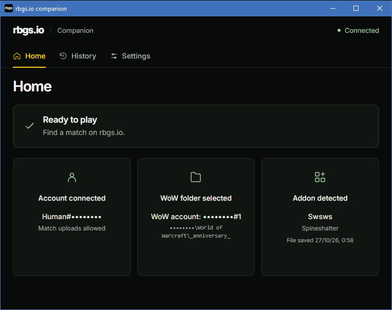

# rbgs.io companion

The Windows companion for [rbgs.io](https://rbgs.io). Connect your account, select your WoW folder, and keep your match captures synced. Get notified when a test match is ready.

## Download

Download **rbgs.io-companion-setup.exe** from the [latest release](https://github.com/gallardoS/companion.rbgs.io/releases/latest) and run the installer.

Open the companion, connect your account, and select your WoW folder. Install and enable the RBGS addon to capture your matches.

## Automatic updates

The companion checks for updates when it starts and every hour while it runs, including in the system tray. To check right away, open **Settings** and click **Check for updates**.

When an update is available, click the yellow notice next to the version number. A popup shows the download and stays open until the updated companion appears. Your connected account, settings, and saved matches are kept.

If you have an older version without automatic updates, download and install the [latest version](https://github.com/gallardoS/companion.rbgs.io/releases/latest) once to enable them.
