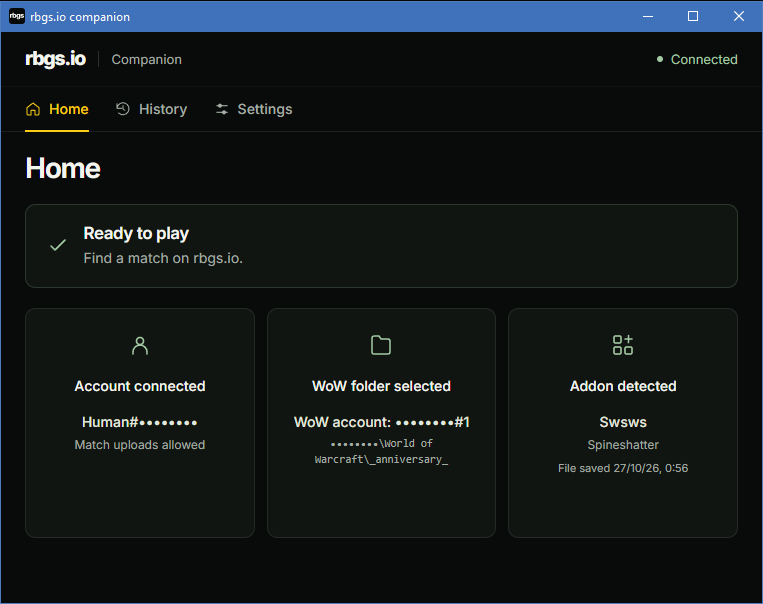

# rbgs.io companion

The Windows companion for [rbgs.io](https://rbgs.io). Connect your account, select your WoW folder, and keep your match captures synced. Get notified when a test match is ready.

## Download

Download **rbgs.io-companion-setup.exe** from the [latest release](https://github.com/gallardoS/companion.rbgs.io/releases/latest) and run the installer.

Open the companion, connect your account, and select your WoW folder. Install and enable the RBGS addon to capture your matches.

## Automatic updates

The companion checks for a newer version when you open it. If an update is available, a popup shows the download progress. The installer then updates the companion and reopens it automatically. Your connected account, settings, and saved matches are kept.

If you are offline or the download fails, you can keep using your current version. The companion will check again the next time you open it.

If you have an older version without automatic updates, download and install the [latest version](https://github.com/gallardoS/companion.rbgs.io/releases/latest) once to enable them.
